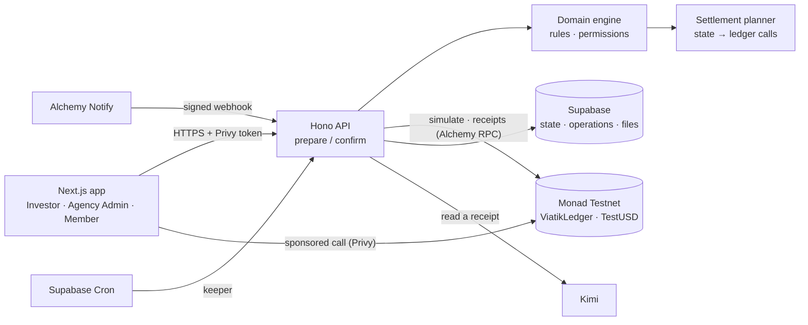

# Viatik

**Programmable funding for modern teams.** Investors fund teams in tranches, budgets carry their own rules, and every payment is checked before it moves. Each money action settles on **Monad Testnet** and leaves a receipt anyone can verify. People see US dollars: no wallet, no seed phrase, no gas fee.

**Live app:** https://viatik.xyz · **Try it without an account:** https://viatik.xyz/sign-in/demo · **Contract:** [ViatikLedger on MonadVision](https://testnet.monadvision.com/address/0x4BB74305A0e4ad5d55652B9d32b15d86d3E42908) · **X:** https://x.com/viatikapp · **Contact:** contact@viatik.xyz

Built for **Monad Metropolis** (Consumer Products & Payments track). Sponsor integrations: **Privy**, **Alchemy** and **Kimi**.

## The problem and who it is for

When an investor, a grant program or a studio funds a team, the money lands in a bank account and goes quiet. Spending is checked later, through spreadsheets and month-end reports. Rules like "nothing over this amount without approval" live in people's heads, and they are checked after the money has already left.

Viatik is for the people on both sides of that money:

- **Investors** (funders, grant programs, studios) who release capital in tranches and want to see where it goes.
- **Agency Admins** (team leads, operators) who turn that capital into budgets and payments.
- **Members** (the people on the team) who spend within clear limits and get paid back.

None of them needs to know anything about crypto.

## What Viatik does

| Role             | What they do                                                                                                                                                                                                              |
| ---------------- | ------------------------------------------------------------------------------------------------------------------------------------------------------------------------------------------------------------------------- |
| **Investor**     | Adds funds to a Portfolio Vault, creates Funding Agreements split into tranches (optionally tied to milestone evidence), funds agreements and releases their tranches, and approves exception payments above a threshold. |
| **Agency Admin** | Accepts agreements, creates budgets with rules (allowed destinations, per-payment limit, approval threshold, allowances), approves requests, pays vendors, the team and addresses outside Viatik, and schedules payments. |
| **Member**       | Requests money from a budget: it is paid at once, held for approval or refused, depending on the rules. Adds receipts and gets reimbursed.                                                                                |

Each role sees only its own scope. Every money action leaves a receipt with its transaction, block and receipt hash.

## How Viatik uses Monad

### Why Monad

- **One transaction per money event.** Low fees make it practical to settle every deposit, release, approval and payment as its own transaction with its own receipt, instead of batching them off-chain.
- **Receipts in the same flow.** Monad's fast blocks and finality let the app show a settled payment, with its transaction and block, on the screen where the person paid.
- **Full EVM compatibility.** The rules are plain Solidity built with Foundry (with the `monad` profile from the official template), and the app talks to the chain with viem.
- **Monad staking.** The Investor's Vaults page reads a real test delegation (validator, stake and rewards) from Monad's staking precompile, as a preview of how rewards on idle capital would be reported.
- **Measured on production.** On 12–13 Oct 2026, three new accounts ran the whole flow on https://viatik.xyz: 19 transactions, all successful (9 of them are listed below). From the click to a confirmed receipt each action took 6.6 to 10.9 s (median 8.6 s), including simulation, the sponsored user operation, inclusion in a block and the server's confirmation. People paid 0 MON: gas was sponsored on every action.

### What settles on chain

Each command that moves money or changes an on-chain rule becomes **one `multicall` transaction** on the `ViatikLedger` contract, signed by the person's own Privy embedded wallet with gas sponsored (scheduled payments are run by the keeper). The contract itself enforces roles, the agreement and tranche states, budget status, allowed destinations, per-payment limits, available funds, approval thresholds and exception routing.

| Product action                                    | ViatikLedger function                                                   |
| ------------------------------------------------- | ----------------------------------------------------------------------- |
| Join a workspace (permit signed by the registrar) | `join`                                                                  |
| Add funds / withdraw                              | `deposit` / `withdraw`                                                  |
| Agreements and tranches                           | `createAgreement`, `acceptAgreement`, `fundAgreement`, `releaseTranche` |
| Budgets and their rules                           | `createBudget`, `allocate`, `updateRules`, `setAllowance`               |
| Member payment request / approval                 | `requestPayment`, `approvePayment`                                      |
| Pay a vendor, a member or the team                | `pay`                                                                   |
| Pay an address outside Viatik, with its invoice   | `payOutside`, `recordEvidence`                                          |
| Return capital or unused funds / withdrawals      | `returnCapital`, `returnToAgency`, `withdrawMemberBalance`              |
| Scheduled payments (run by the keeper)            | `createSchedule`, `runSchedule`                                         |

A request that breaks a budget rule does not revert: it is recorded as `PaymentRejected`, so even a "no" leaves a receipt. Every money action emits `Recorded(opId, actor, receiptHash)` with `receiptHash = keccak256(abi.encode(opId, kind, amount, from, to, evidenceHash))`. Files never go on chain, only their SHA-256 fingerprints.

### Contracts (Monad Testnet, chain 10143)

| Contract                        | Address                                                                                                                            | Verification                                                                                                                                               |
| ------------------------------- | ---------------------------------------------------------------------------------------------------------------------------------- | ---------------------------------------------------------------------------------------------------------------------------------------------------------- |
| **ViatikLedger v3**             | [`0x4BB74305A0e4ad5d55652B9d32b15d86d3E42908`](https://testnet.monadvision.com/address/0x4BB74305A0e4ad5d55652B9d32b15d86d3E42908) | Verified on Sourcify through MonadVision ([JSON](https://sourcify-api-monad.blockvision.org/v2/contract/10143/0x4BB74305A0e4ad5d55652B9d32b15d86d3E42908)) |
| **TestUSD** (vtUSD, 6 decimals) | [`0xE14D62136Bcc0C668755f69F04Cfa97b079BB246`](https://testnet.monadvision.com/address/0xE14D62136Bcc0C668755f69F04Cfa97b079BB246) | Verified on Sourcify through MonadVision ([JSON](https://sourcify-api-monad.blockvision.org/v2/contract/10143/0xE14D62136Bcc0C668755f69F04Cfa97b079BB246)) |

The ledger was created in [`0xd4f2d358…752983f5`](https://testnet.monadvision.com/tx/0xd4f2d35870b71a501c8765ca4993e5868bcb662c30e7c59a66779ffb752983f5) (block 69,348,361). Earlier versions (v1, v2) are kept in [`contracts/broadcast`](contracts/broadcast).

### Transactions from real accounts

Made on https://viatik.xyz on 12–13 Oct 2026 by three new accounts: an Investor, an Agency Admin and a Member. Each is a sponsored `handleOps` call through the ERC-4337 EntryPoint, whose user operation is sent by the person's embedded wallet.

| Action                                                  | Function                    | Transaction                                                                                                                    |
| ------------------------------------------------------- | --------------------------- | ------------------------------------------------------------------------------------------------------------------------------ |
| Investor adds 100,000 to the Portfolio Vault            | `deposit`                   | [`0xabcc9927…d9b77dff`](https://testnet.monadvision.com/tx/0xabcc9927150010e6d83ca2a2fd5368ec322b7311cf4ee6e7636b8a33d9b77dff) |
| Investor creates an agreement of 80,000 in 4 tranches   | `createAgreement`           | [`0xe3e229f4…72de1410`](https://testnet.monadvision.com/tx/0xe3e229f4db161bb5be02b37427c8ab316a9be6154201dadba9f92fa772de1410) |
| Agency Admin accepts the agreement                      | `acceptAgreement`           | [`0x87f41fac…5319b0d0`](https://testnet.monadvision.com/tx/0x87f41fac37452b470e25aba0c070d4bb918ad2c0ecaf85c286c7f1105319b0d0) |
| Investor releases tranche 1 (20,000)                    | `releaseTranche`            | [`0xd09948fd…f01826ee`](https://testnet.monadvision.com/tx/0xd09948fd817f655e6bd3ef66990d4ef46390b1db71deedc717289169f01826ee) |
| Member requests 120: paid at once by the budget's rules | `requestPayment`            | [`0x760acc58…a45380c8`](https://testnet.monadvision.com/tx/0x760acc58e71224c4fb2b558a8a5339304099d5354a38baf15d82550fa45380c8) |
| Member requests 1,500: over the limit, refused on chain | `requestPayment` (rejected) | [`0xda0a6279…a7d68998`](https://testnet.monadvision.com/tx/0xda0a627933975d5fd76d845eb94fa37db1829501593280671b05bbfda7d68998) |
| Agency Admin approves and pays a held request of 450    | `approvePayment`            | [`0xb06a6357…0446dae9`](https://testnet.monadvision.com/tx/0xb06a6357c8a3c5bc291b5f7004f3c310bdd23fd9192286ae4800fb3e0446dae9) |
| Agency Admin pays an invoice read by Kimi               | `payOutside`                | [`0xbc9ccf10…42fea6d8`](https://testnet.monadvision.com/tx/0xbc9ccf106736e174b721654e398dca9e0f2f1c281bc5cc0e4bfd0e5c42fea6d8) |
| Member sends 500 to their own account                   | `withdrawMemberBalance`     | [`0xdfb2cdaa…730e968d`](https://testnet.monadvision.com/tx/0xdfb2cdaaccfb5ec2bfe555fb606b46657487672cc169331d55d8778f730e968d) |

## Architecture



1. **Prepare.** The server checks the person's Privy token and input, runs the domain engine, turns the state change into ledger calls, simulates the `multicall` and stores a pending operation.
2. **Sign.** The browser sends the prepared call through Privy from the person's embedded wallet, with gas sponsored.
3. **Confirm.** The server reads the receipt and the ViatikLedger events, checks every event and receipt hash against the plan, and saves the settled state.

The same domain engine runs in the browser for the no-account demo, against a mock ledger with the contract's limits, so the demo and real accounts behave the same. Main folders: [`contracts`](contracts) (Foundry), [`src/domain`](src/domain) (engine), [`src/data`](src/data) (data sources, settlement planner), [`src/ledger`](src/ledger) (Monad adapter), [`src/server`](src/server) (API, keeper, webhooks, Kimi reader), [`src/app`](src/app) (pages).

## Tech stack

| Layer    | Technology                                                                               |
| -------- | ---------------------------------------------------------------------------------------- |
| App      | Next.js 16 (App Router), React 19, TypeScript, Tailwind CSS 4, shadcn/ui, TanStack Query |
| API      | Hono on Next.js route handlers, zod                                                      |
| Chain    | Monad Testnet (10143), Solidity 0.8.30, Foundry, OpenZeppelin Contracts 5, viem          |
| Accounts | Privy (email, Google, passkey; embedded wallets; gas sponsorship)                        |
| Data     | Supabase Postgres, Storage and Cron                                                      |
| Sponsors | Alchemy (RPC, Notify webhooks), Kimi by Moonshot AI (document reading)                   |
| Hosting  | Hostinger (production), Vercel (staging)                                                 |

## Sponsor integrations

**Privy.** Sign-in with email, Google or a passkey. On first sign-in the server pregenerates an embedded wallet for the person (`pregenerateWallets`), and every money action is sent with `useSendTransaction(..., { sponsor: true })` with the wallet screens hidden. The server verifies every access token, and only the wallet a call was prepared for may sign it. Code: [`src/lib/privy.tsx`](src/lib/privy.tsx), [`src/lib/session.tsx`](src/lib/session.tsx), [`src/server/session.ts`](src/server/session.ts), [`src/components/app/passkeys-panel.tsx`](src/components/app/passkeys-panel.tsx).

**Alchemy.** Production uses Alchemy's Monad Testnet RPC for reads, simulations and receipts. An Address Activity webhook tells a person when TestUSD reaches their account ("Funds arrived", or "Test funds arrived" for test mints). New accounts are added to the webhook at sign-in through Alchemy's API. The route checks the HMAC-SHA256 signature in constant time and reports each transfer once. Code: [`src/server/webhooks.ts`](src/server/webhooks.ts).

**Kimi.** A person adds a receipt or an invoice and presses **Read with Kimi**. Kimi (`kimi-k3`) returns the merchant, total, currency, date, whether it is a monthly charge and which open item it matches, under a strict JSON schema. The server checks every field before proposing anything, and the person confirms. Kimi never moves money, never submits and never proposes a payee's address. Code: [`src/server/receipt-reader.ts`](src/server/receipt-reader.ts), [`src/components/app/kimi-reader.tsx`](src/components/app/kimi-reader.tsx). The no-account demo shows recorded readings of sample documents, labelled as recorded.

## Getting started

**Prerequisites:** Node.js 22, pnpm 10 (`corepack enable`), and Foundry for the contracts.

### Run the demo locally (no keys needed)

```bash
pnpm install
pnpm dev
```

Open http://localhost:3000/sign-in/demo and pick Investor, Agency Admin or Member. With the default settings the whole product runs in the browser against a mock ledger: no keys and no Monad transactions.

| Command                  | What it does                              |
| ------------------------ | ----------------------------------------- |
| `pnpm dev`               | Development server                        |
| `pnpm build`             | Production build (`next build --webpack`) |
| `pnpm lint`              | ESLint                                    |
| `pnpm typecheck`         | Type checks                               |
| `node scripts/smoke.mjs` | Smoke test suites (no keys, no network)   |

### Run with real accounts on Monad

Copy [`.env.example`](.env.example) to `.env.local`, set `NEXT_PUBLIC_DATA_SOURCE=api` and fill in the values (each variable is described there and validated by [`src/lib/env.ts`](src/lib/env.ts)). You need:

1. A **Privy app** with email, Google and passkey login, and gas sponsorship on Monad Testnet.
2. A **Supabase project** with the tables below and a private Storage bucket named `evidence`.
3. **Your own ViatikLedger deployment** in `VIATIK_LEDGER_ADDRESS` and its registrar key in `LEDGER_REGISTRAR_PRIVATE_KEY` (joining a workspace needs permits signed by the ledger's registrar, so a clone cannot sign people up on the public deployment).
4. A Monad Testnet RPC URL in `MONAD_RPC_URL`.

<details>
<summary><strong>SQL for the Supabase tables</strong></summary>

```sql
create table users (
  id text primary key, privy_id text not null unique, email text, name text, wallet_address text,
  created_at timestamptz not null default now(), last_seen_at timestamptz not null default now()
);

create table world_state (                 -- a single row 'main'
  id text primary key, state jsonb not null, version integer not null default 1,
  ledger jsonb,
  updated_at timestamptz not null default now()
);

create table operations (
  user_id text not null, idempotency_key text not null, command text not null, fingerprint text not null,
  status text not null default 'done',
  status_code integer not null, response jsonb not null, input jsonb, prepared jsonb,
  prepared_at timestamptz, world_version integer, tx_hash text, scanned_to integer,
  created_at timestamptz not null default now(), expires_at timestamptz not null,
  primary key (user_id, idempotency_key)
);

create table uploads (
  id text primary key, user_id text not null, sha256 text not null, path text not null unique,
  name text not null, mime_type text not null, size_bytes integer not null,
  status text not null default 'pending',
  created_at timestamptz not null default now(), verified_at timestamptz
);

alter table users enable row level security;
alter table world_state enable row level security;
alter table operations enable row level security;
alter table uploads enable row level security;
```

</details>

<details>
<summary><strong>Deploy and verify the contracts (Foundry)</strong></summary>

```bash
cd contracts
forge test                              # local tests
FOUNDRY_PROFILE=monad forge test        # Monad execution rules

# Deploy (only on chain 10143 or a local chain)
DEPLOYER_PRIVATE_KEY=<testnet key> FOUNDRY_PROFILE=monad \
  forge script script/Deploy.s.sol --rpc-url monad_testnet --broadcast

# Verify on MonadVision (Sourcify)
forge verify-contract <address> src/ViatikLedger.sol:ViatikLedger --chain 10143 \
  --verifier sourcify --verifier-url https://sourcify-api-monad.blockvision.org/ \
  --constructor-args "$(cast abi-encode 'constructor(address,address,address)' <token> <registrar> <payout sink>)"
```

Then seed the world once the people listed in `DEMO_ACCOUNTS` have signed in: `curl -X POST "<origin>/api/v1/admin/seed" -H "x-admin-token: <ADMIN_SEED_TOKEN>"`.

</details>

<details>
<summary><strong>Optional: keeper, Alchemy webhook and Kimi</strong></summary>

- **Keeper (scheduled payments).** Set `KEEPER_TRIGGER_TOKEN` and run [`scripts/keeper-cron.sql`](scripts/keeper-cron.sql) in Supabase (replace its placeholders in a local copy) to call `/api/v1/keeper/run` every 10 minutes.
- **Alchemy webhook.** Create an Address Activity webhook on Monad Testnet pointing to `<origin>/api/v1/webhooks/alchemy`, set `ALCHEMY_WEBHOOK_SIGNING_KEY`, `ALCHEMY_WEBHOOK_ID` and `ALCHEMY_NOTIFY_AUTH_TOKEN`, then run `node scripts/alchemy-sync-addresses.mjs --apply`.
- **Kimi.** Set `KIMI_API_KEY` (and optionally `KIMI_MODEL`).

</details>

## Tests

- **Contracts:** after `pnpm install`, `cd contracts && forge test` passes all 254 tests forge reports: unit and fuzz tests, plus a stateful campaign that checks 13 invariants against a reference model of every balance. They pass with both the default and the `monad` profile.
- **App:** `node scripts/smoke.mjs` runs 1,937 checks in 8 suites (engine, settlement, genesis, alchemy, kimi, schedules, client, format), with no keys and no network.
- **Static checks:** `pnpm lint` and `pnpm typecheck`.

All of the above pass on commit `fe838e4`.

## Security and limitations

- **Testnet only.** Viatik runs on Monad Testnet. TestUSD is a test token that stands in for USDC: anyone can mint it.
- **Custody.** Money is held by the ViatikLedger contract and moves only when a person's embedded wallet signs the prepared call, or when the keeper runs a schedule an admin created. One operator address is the ledger's owner, registrar, payout sink and keeper: a testnet convenience, not a production trust model.
- **Vendor payouts** inside Viatik go to that operator's payout address. "Pay outside Viatik" is the path to any address.
- **Rules split between chain and server.** Period limits, categories and expiry are enforced by the app's engine, not by the contract. So is the rule that an admin cannot pay themselves.
- **Completed agreements** are a display state: the contract keeps no closed state for an agreement.
- **Not included:** external wallet connection and database migration files (see the SQL above).

## Hackathon disclosures

**Build window.** The repository starts at `01a2edd` on 23 Sep 2026, inside the build window, and its full history (149 commits up to `fe838e4`) is public.

**Pre-existing work.** No code in this repository was written before the build window. Two parts were made outside the repository, also within the window:

- The first version of the marketing landing was generated with **v0 by Vercel** around 20–23 Sep 2026 and ported on 23 Sep (`887a8b1`, `a843001`); it was largely redesigned later.
- A same-week prototype (private, 23 Sep 2026) provided the first money helpers, components, domain engine and screens, ported with review between 23 and 29 Sep.

The brand logos in `public/brand` are Viatik's own files.

**AI tools.** As the rules allow, AI coding tools were used:

- **Claude Code (Anthropic)** was the main coding assistant and wrote a large share of the code under the author's direction. 88 of those 149 commits show Claude as author or co-author.
- **v0 by Vercel** generated the first landing draft.

The author defined the product and its roles, made the product and architecture decisions, reviewed every change, tested the app with real accounts and made the commits. Kimi is a product feature, not a coding tool.

**Third-party code and attribution.**

- [shadcn/ui](https://ui.shadcn.com) components in `src/components/ui` (MIT).
- [OpenZeppelin Contracts](https://github.com/OpenZeppelin/openzeppelin-contracts) 5.6.1 (MIT) and [forge-std](https://github.com/foundry-rs/forge-std) (MIT or Apache-2.0).
- Foundry configuration based on [monad-developers/foundry-monad](https://github.com/monad-developers/foundry-monad). Staking precompile ABI from [docs.monad.xyz](https://docs.monad.xyz).
- Fonts Inter, Archivo and JetBrains Mono under the SIL Open Font License 1.1 (license files in `src/fonts`).
- Photos from [Unsplash](https://unsplash.com) under the Unsplash License, credited to their photographers: [Kalen Emsley](https://unsplash.com/photos/Bkci_8qcdvQ) (`alpine-landscape.jpg`), [Annie Spratt](https://unsplash.com/photos/QckxruozjRg) (`creative-team.jpg`) and [Lance Anderson](https://unsplash.com/photos/QdAAasrZhdk) (`modern-architecture.jpg`). The film grain texture is generated by [`scripts/film-grain.mjs`](scripts/film-grain.mjs).
- npm dependencies under MIT, Apache-2.0, ISC and Unlicense licenses (see `package.json`).

## License

[MIT](LICENSE). Third-party components keep their own licenses.

Built by Jeniffer ([@Jennimar17](https://github.com/Jennimar17)).
