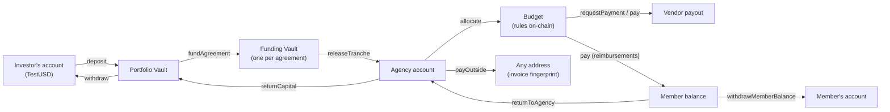
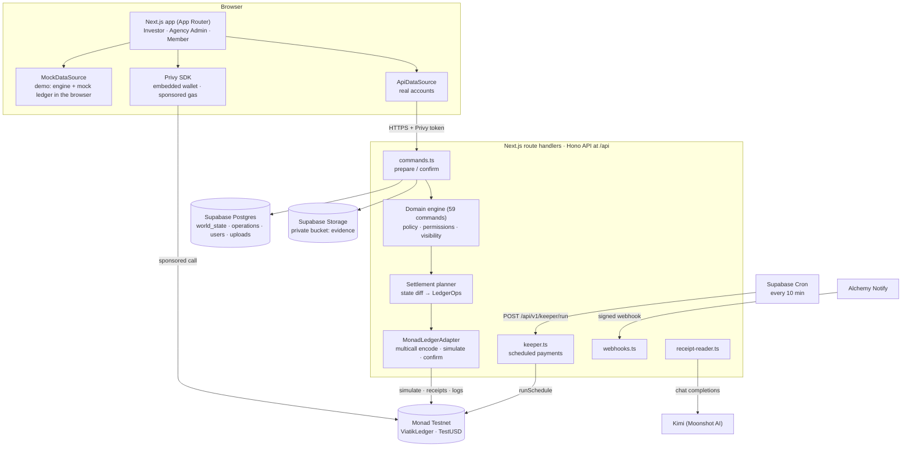
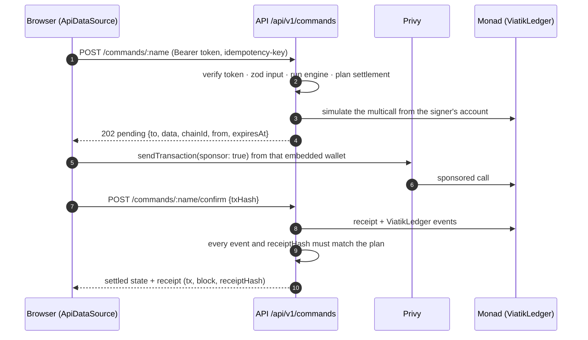

# Viatik

**Programmable funding for teams.** Investors fund Agencies through Funding Agreements, Agencies turn released capital into accounts, budgets and payments, and Members spend within clear rules. For real accounts, every money action settles on Monad Testnet and leaves a receipt that anyone can check (the no-account demo simulates it in the browser). People see US dollars. They never see a wallet, a seed phrase or a gas fee.

**Live app:** https://viatik.xyz · **Try it without an account:** https://viatik.xyz/sign-in/demo · **Demo video:** _coming before 13 Oct_ · **X:** https://x.com/viatikapp · **Contract:** [ViatikLedger on MonadVision](https://testnet.monadvision.com/address/0x4BB74305A0e4ad5d55652B9d32b15d86d3E42908) · **Contact:** contact@viatik.xyz

Built for **Monad Metropolis** (build window 1 Sep – 13 Oct 2026), Consumer Products & Payments track. Sponsor integrations: **Privy**, **Alchemy** and **Kimi**.

<!--
TODO(author) before submitting:
1. Demo video: replace "_coming before 13 Oct_" in the link row above and in "Demo video" below (3 minutes or less, recorded with a REAL signed-in account: the no-account demo sends no Monad transactions).
2. Medium article: replace the placeholder in the Kimi section.
3. Make the GitHub repo public (the build log says its history is public).
4. (done) LICENSE is committed with this README.
5. Fill in the "v3 transactions from real accounts" table from app receipts.
6. On the final commit: re-run `node scripts/smoke.mjs` and `cd contracts && forge test`, then update the counts, hashes and dates in "Testing", "For judges" and the build log; recount commits (`git rev-list --count HEAD`) and Claude commits (`git log --format='%an %(trailers:key=Co-Authored-By)' | grep -ci claude`).
7. BLOCKER: document the source and license of public/images/* or replace those files (see Pre-existing work).
-->

## Demo video

_Coming before 13 Oct._ The video (3 minutes or less) uses a real signed-in account on https://viatik.xyz, so every step settles on Monad Testnet: sign in, add funds, a payment request and its approval, the receipt opened on MonadVision, and a Kimi read of a receipt.

## For judges: where to look

| You want to see                      | Go to                                                                                                                                                                                                                   |
| ------------------------------------ | ----------------------------------------------------------------------------------------------------------------------------------------------------------------------------------------------------------------------- |
| The product in 2 minutes, no account | https://viatik.xyz/sign-in/demo, then pick Investor, Agency Admin or Member (simulated in the browser; no on-chain transactions)                                                                                        |
| Real accounts settling on Monad      | https://viatik.xyz/sign-in (email, Google or passkey; gas is sponsored). Steps: [Try it on Monad](#try-it-on-monad-real-account)                                                                                        |
| The contract                         | [`contracts/src/ViatikLedger.sol`](contracts/src/ViatikLedger.sol): v3 at [`0x4BB7…2908`](https://testnet.monadvision.com/address/0x4BB74305A0e4ad5d55652B9d32b15d86d3E42908), verified on Sourcify through MonadVision |
| On-chain proof                       | [Deployed contracts and transactions](#deployed-contracts-monad-testnet-chain-10143)                                                                                                                                    |
| How a money action reaches Monad     | [`src/server/commands.ts`](src/server/commands.ts), [`src/data/settlement.ts`](src/data/settlement.ts), [`src/ledger/monad.ts`](src/ledger/monad.ts), [`src/lib/session.tsx`](src/lib/session.tsx)                      |
| Sponsor integrations                 | [Privy, Alchemy, Kimi](#sponsor-integrations)                                                                                                                                                                           |
| Tests                                | 266 Foundry tests (253 unit and fuzz tests, 6 of them fuzz, plus 13 stateful invariants) and 1,572 smoke checks across 6 suites, all passing on `78eb601`: [Testing](#testing)                                          |
| Hackathon disclosures                | [Pre-existing work](#pre-existing-work), [AI tools](#ai-tools-disclosure), [Build log](#build-log)                                                                                                                      |

### Try it on Monad (real account)

1. Open https://viatik.xyz/sign-in and sign in with email, Google or a passkey. You do not need a wallet or MON.
2. On the welcome page, choose **Investor**, name the portfolio, tick the confirmation and press **Create portfolio**.
3. Go to **Vaults ▸ Add funds**. Press **Get test funds** (TestUSD minted to your Viatik account, gas sponsored), then **Transfer to Portfolio**. The transfer is a `deposit` on ViatikLedger, signed by your embedded wallet.
4. When the sheet says **Funds credited**, press **View verified details**, then **View in explorer**. MonadVision shows the transaction, and the verified details list its block and receipt hash.
5. To see budgets, payment requests, approvals and Kimi, invite an Agency Admin from your portfolio, and have the Admin invite a Member. With a real account, the Kimi reader reads your own files live in **Member ▸ Expenses ▸ Add receipt** and **Agency Admin ▸ Accounts ▸ Pay outside Viatik**. The no-account demo shows Kimi's recorded readings of sample documents there instead, labelled as recorded.

## The problem

When an investor funds a team or an agency, the money disappears into a bank account. From then on, visibility depends on spreadsheets, card statements and month-end reports. The agency juggles cards, transfers and reimbursements. Team members pay out of pocket and wait to be paid back. Receipts get lost. Rules like "nothing over this amount without approval" or "only pay these vendors" live in people's heads and are checked after the money has already left.

Viatik builds those rules into the money itself. Capital is released in tranches, budgets carry their own limits, and every payment is checked before it moves. Each step leaves a receipt that the investor, the agency and the member can all verify.

## What Viatik does

One app serves three roles. Each role sees only its own scope.

**Investor** (portfolio scope)

- Adds funds to a **Portfolio Vault** and withdraws from it.
- Creates **Funding Agreements** with an Agency: a committed amount split into tranches. A tranche can be tied to a milestone that needs evidence.
- Funds an agreement, then reviews and **releases tranches**. A release records a decision fingerprint. Nobody can release their own request.
- Approves **exception payments**, the ones above the agency's exception threshold, and can pause an agreement or a scheduled payment.
- Follows each agency through reports and activity, and receives capital an agency returns.

**Agency Admin** (agency scope)

- Accepts agreements and receives released capital into **agency accounts**.
- Creates **budgets** with rules: allowed destinations, a per-operation limit and an approval threshold. Budgets can be paused, and admins set member allowances.
- Approves member requests, pays vendors, members and the whole team, and **pays outside Viatik** to any address, with the invoice attached then or later.
- Manages providers, bills (with reconciliation), monthly payments and **scheduled payments** that a keeper runs on time.
- Returns unused capital to the Investor.

**Member** (agency scope)

- Spends from their budget. A payment request is paid at once, held for approval or rejected, depending on the budget's rules.
- Adds expenses with their receipts, and gets reimbursed.
- Keeps a member balance per agency, returns money to the agency and withdraws.

### The money flow



Every arrow is a ViatikLedger function. The budget rules that the contract enforces itself are: the budget is active, the destination is allowed, the per-operation limit holds, and the budget has the funds. Period limits, categories and expiry are enforced by the app's domain engine.

## Built on Monad

### Why Monad

- **Each money event is its own on-chain action.** Low fees make it practical to settle every deposit, release, approval and payment as its own transaction with its own receipt, instead of batching or netting them off-chain.
- **Receipts at payment speed.** The server waits up to 15 seconds for a receipt after the person signs. Monad's fast blocks and finality let the app show a settled payment, with its transaction and block, in the same flow where the person paid.
- **Full EVM compatibility.** The contract is plain Solidity built with Foundry, and the app talks to it with viem. The Foundry config follows the official Monad template, with a `monad` profile that applies Monad's execution rules.
- **Native staking precompile.** The Investor's Vaults page reads Monad's staking precompile to preview how rewards on idle assets would be reported (read-only; see below).

### What settles on chain

When the app runs against Monad (`NEXT_PUBLIC_DATA_SOURCE=api` with a ledger configured), each command that moves money or changes a rule becomes **one `multicall` transaction**. The person's own embedded wallet signs it, and Privy sponsors the gas.

| Product action                                                       | ViatikLedger function                                                                                 |
| -------------------------------------------------------------------- | ----------------------------------------------------------------------------------------------------- |
| Join a portfolio or agency (EIP-712 permit from the registrar)       | `join`                                                                                                |
| Add funds / withdraw from the Portfolio Vault                        | `deposit` (pulls TestUSD with `transferFrom`) / `withdraw`                                            |
| Create, accept, pause and fund an agreement                          | `createAgreement`, `acceptAgreement`, `setAgreementPaused`, `fundAgreement`                           |
| Request a tranche (milestone evidence) / ask for changes / release   | `requestTranche`, `requestChanges`, `releaseTranche`                                                  |
| Create and fund a budget, change its rules, pause it, set allowances | `createBudget`, `allocate`, `updateRules`, `setBudgetPaused`, `setAllowance`                          |
| Member payment request                                               | `requestPayment`: pays, holds for approval or records a rejection                                     |
| Approve or close a request                                           | `approvePayment`, `closeRequest`                                                                      |
| Admin pays a vendor, a member or the team                            | `pay` (team payments in one multicall)                                                                |
| Pay outside Viatik / anchor an invoice                               | `payOutside`, `recordEvidence`                                                                        |
| Move money between agency accounts                                   | `transfer`                                                                                            |
| Member returns money / withdraws                                     | `returnToAgency`, `withdrawMemberBalance`                                                             |
| Return capital to the Investor                                       | `returnCapital`                                                                                       |
| Scheduled payments                                                   | `createSchedule`, `pauseSchedule`, `resumeSchedule`, `cancelSchedule`; the keeper calls `runSchedule` |

**`requestPayment` never reverts because of a budget rule.** A rejection is a successful transaction that emits `PaymentRejected`, because a reverting call cannot be sponsored. The refusal itself is recorded on-chain.

**Receipts you can recompute.** Every money action emits `Recorded(opId, actor, receiptHash)` with

```
receiptHash = keccak256(abi.encode(opId, kind, amount, from, to, evidenceHash))
```

The receipt kinds are Deposit, Funding, TrancheRelease, Transfer, Payment, PaymentPending, PaymentRejected, Return, Allocation, Withdrawal, OutsidePayment and CapitalReturn. Each (actor, opId) pair runs only once. Evidence files never go on-chain. Only their SHA-256 fingerprints do: a payment's attachments become one `evidenceSetHash`, and a milestone decision becomes a `decisionHash`. For real accounts, each receipt in the app shows its transaction, block, contract, receipt hash and a MonadVision link.

### Deployed contracts (Monad Testnet, chain 10143)

| Contract                        | Address                                                                                                                            | Created in                                                                                                                                   | Verification                                                                                                                                                                                                                                                 |
| ------------------------------- | ---------------------------------------------------------------------------------------------------------------------------------- | -------------------------------------------------------------------------------------------------------------------------------------------- | ------------------------------------------------------------------------------------------------------------------------------------------------------------------------------------------------------------------------------------------------------------ |
| **ViatikLedger v3** (current)   | [`0x4BB74305A0e4ad5d55652B9d32b15d86d3E42908`](https://testnet.monadvision.com/address/0x4BB74305A0e4ad5d55652B9d32b15d86d3E42908) | [`0xd4f2d358…83f5`](https://testnet.monadvision.com/tx/0xd4f2d35870b71a501c8765ca4993e5868bcb662c30e7c59a66779ffb752983f5), block 69,348,361 | [Verified on Sourcify via MonadVision (runtime match)](https://testnet.monadvision.com/address/0x4BB74305A0e4ad5d55652B9d32b15d86d3E42908) · [JSON](https://sourcify-api-monad.blockvision.org/v2/contract/10143/0x4BB74305A0e4ad5d55652B9d32b15d86d3E42908) |
| **TestUSD** (vtUSD, 6 decimals) | [`0xE14D62136Bcc0C668755f69F04Cfa97b079BB246`](https://testnet.monadvision.com/address/0xE14D62136Bcc0C668755f69F04Cfa97b079BB246) | [`0xfece3529…3dbd`](https://testnet.monadvision.com/tx/0xfece35299cff93f15110958d63fd53112bf604c19574b932185d32ec95f63dbd), block 69,171,978 | [Verified on Sourcify via MonadVision (runtime match)](https://testnet.monadvision.com/address/0xE14D62136Bcc0C668755f69F04Cfa97b079BB246) · [JSON](https://sourcify-api-monad.blockvision.org/v2/contract/10143/0xE14D62136Bcc0C668755f69F04Cfa97b079BB246) |
| Staking precompile (read only)  | `0x0000000000000000000000000000000000001000`                                                                                       | Monad system contract                                                                                                                        | —                                                                                                                                                                                                                                                            |

- The owner, registrar, payout sink and keeper of the v3 ledger are all `0x19F79Be75A05360af0BED0D99d9317eE3Df6D6c9` (the deployer). See [Security and limitations](#security-and-limitations).
- The v3 deployment reused the TestUSD created in the v2 run. The broadcast is in [`contracts/broadcast/Deploy.s.sol/10143/run-latest.json`](contracts/broadcast/Deploy.s.sol/10143/run-latest.json).
- Both contracts are verified through MonadVision's Sourcify endpoint (`https://sourcify-api-monad.blockvision.org/`), which reports a runtime match (`"match": "match"`). The build sets `bytecode_hash = "none"`, so an exact metadata match is not possible. The contracts are not listed on sourcify.dev.

**Key transactions**

| What                                                                        | Transaction                                                                                                                                                                   | Block      |
| --------------------------------------------------------------------------- | ----------------------------------------------------------------------------------------------------------------------------------------------------------------------------- | ---------- |
| v3 ledger created                                                           | [`0xd4f2d35870b71a501c8765ca4993e5868bcb662c30e7c59a66779ffb752983f5`](https://testnet.monadvision.com/tx/0xd4f2d35870b71a501c8765ca4993e5868bcb662c30e7c59a66779ffb752983f5) | 69,348,361 |
| v3 `setKeeper`                                                              | [`0x58f3ef32b4c56c4b9c02dc189b9971f252e38172281b1d7691ee59405b2b7d80`](https://testnet.monadvision.com/tx/0x58f3ef32b4c56c4b9c02dc189b9971f252e38172281b1d7691ee59405b2b7d80) | 69,348,369 |
| Production genesis: the whole world seeded in one owner multicall (85 logs) | [`0x2d1ae05f1fe17792ac1062c08e61637574549147809a58ce427678699a6a18df`](https://testnet.monadvision.com/tx/0x2d1ae05f1fe17792ac1062c08e61637574549147809a58ce427678699a6a18df) | 69,982,274 |
| TestUSD created                                                             | [`0xfece35299cff93f15110958d63fd53112bf604c19574b932185d32ec95f63dbd`](https://testnet.monadvision.com/tx/0xfece35299cff93f15110958d63fd53112bf604c19574b932185d32ec95f63dbd) | 69,171,978 |
| Test stake: `delegate(1)` with 3 MON                                        | [`0xbe101daed02066da327765aeb3b98c842f319c252f4ed16f7d0b5203a8694d22`](https://testnet.monadvision.com/tx/0xbe101daed02066da327765aeb3b98c842f319c252f4ed16f7d0b5203a8694d22) | 69,173,908 |

After the genesis, money actions in production are signed by people's own embedded wallets, and each receipt in the app links to its transaction.

**v3 transactions from real accounts** on https://viatik.xyz, each opened from its receipt in the app:

| Product action                             | ViatikLedger function | Transaction                           |
| ------------------------------------------ | --------------------- | ------------------------------------- |
| Investor adds funds to the Portfolio Vault | `deposit`             | _to be added from the final test run_ |
| Investor releases a tranche                | `releaseTranche`      | _to be added from the final test run_ |
| Member payment request                     | `requestPayment`      | _to be added from the final test run_ |
| Agency Admin pays outside Viatik           | `payOutside`          | _to be added from the final test run_ |
| Keeper runs a scheduled payment            | `runSchedule`         | _to be added from the final test run_ |

<!-- TODO(author): paste 3–5 real v3 tx hashes here from app receipts (View verified details ▸ View in explorer) after the production test run, as [`0xabcd…1234`](https://testnet.monadvision.com/tx/<hash>). On 11 Oct 2026 the production `operations` table had no settled user operation on v3 yet, so none could be listed when this README was written. Delete rows you cannot fill. -->

**Superseded deployments**, kept for history (the app no longer uses them):

| Version | ViatikLedger                                                                                                                       | Notes                                                                                                                                                                                                                                                                                                                                                                                                                                                                                                                                                                                                                                                                                                                                                 |
| ------- | ---------------------------------------------------------------------------------------------------------------------------------- | ----------------------------------------------------------------------------------------------------------------------------------------------------------------------------------------------------------------------------------------------------------------------------------------------------------------------------------------------------------------------------------------------------------------------------------------------------------------------------------------------------------------------------------------------------------------------------------------------------------------------------------------------------------------------------------------------------------------------------------------------------- |
| v2      | [`0xf3e82D8608F688483695A70694f267374300193C`](https://testnet.monadvision.com/address/0xf3e82D8608F688483695A70694f267374300193C) | Created in [`0x5edb8f16…44bc`](https://testnet.monadvision.com/tx/0x5edb8f16794d8f7a91c817ace8910e81a9c7068455f07973d3b45a00a97044bc), block 69,171,982. Same TestUSD as v3.                                                                                                                                                                                                                                                                                                                                                                                                                                                                                                                                                                          |
| v1      | [`0x58e316B722006F5961ED3A6cDbF54A06b7C6d4C6`](https://testnet.monadvision.com/address/0x58e316B722006F5961ED3A6cDbF54A06b7C6d4C6) | With TestUSD [`0xDcA5eE89…D65C`](https://testnet.monadvision.com/address/0xDcA5eE8982675C7bf7E8a2da84Cc2F1a4EFaD65C). The Foundry smoke run against v1 sent 19 transactions (blocks 67,763,251–67,763,319, all successful): a portfolio, an agreement, a tranche release, and payments of 120 (paid), 900 (rejected) and 300 (held, then approved). For example [createPortfolio](https://testnet.monadvision.com/tx/0x4488d65a600d31a785b974534418081bade3f0f00a12a202bed6c548a4be9fd5) and [releaseTranche](https://testnet.monadvision.com/tx/0x249884663c4ea1b3888f3f407047e2cefba287ac3d36ac8892911c39036cdf6f). All 19 are in [`contracts/broadcast/Smoke.s.sol/10143/run-latest.json`](contracts/broadcast/Smoke.s.sol/10143/run-latest.json). |

### Staking precompile (network yield preview)

The Investor's Vaults page shows a read-only preview of how rewards on idle assets would be reported. It reads Monad's staking precompile (`0x…1000`) for Viatik's own test stake: the deployer delegated 3 MON to validator 1 ([tx](https://testnet.monadvision.com/tx/0xbe101daed02066da327765aeb3b98c842f319c252f4ed16f7d0b5203a8694d22)). This stake is never anyone's capital and is never counted in a portfolio. It is served by `GET /api/v1/ledger/yield` and configured in [`src/web3/addresses.ts`](src/web3/addresses.ts).

## Sponsor integrations

### Privy: accounts, embedded wallets and sponsored gas

- **What it does.** People sign in with email, Google or a passkey (`loginMethods: ['email','google','passkey']`), with Monad as the default chain. On first sign-in the server **pregenerates** an Ethereum embedded wallet for the person (`privy.users().pregenerateWallets`). Every money action is sent with `useSendTransaction(..., { sponsor: true })` and wallet screens hidden, so nobody installs an extension, holds MON or approves a gas fee.
- **Security.** The server verifies every access token (`verifyAccessToken`) and reads the identity token. Only the embedded wallet a call was prepared for may sign it. Passkeys can be linked and unlinked from settings.
- **Where in the code.** [`src/lib/privy.tsx`](src/lib/privy.tsx) (provider), [`src/lib/session.tsx`](src/lib/session.tsx) (sign-in and the sponsored `sendCall`), [`src/server/session.ts`](src/server/session.ts) (token checks and wallet pregeneration), [`src/server/privy.ts`](src/server/privy.ts), [`src/components/app/passkeys-panel.tsx`](src/components/app/passkeys-panel.tsx) and [`src/components/app/sponsorship-check.tsx`](src/components/app/sponsorship-check.tsx) (sponsored mint and approve check).
- **Why it matters.** The track asks for a payments app that never mentions blockchain. Privy is how Viatik delivers that: the person sees "Sign in" and "Pay", and Monad does the settling underneath. Sponsored calls go through ERC-4337 user operations (EntryPoint v0.7). The confirmation step reads only the logs from the prepared account's own user operation.

### Alchemy: RPC and "Funds arrived" notices

- **What it does.** `MONAD_RPC_URL` can point to an Alchemy Monad Testnet URL for reads, simulations and receipts. An **Address Activity webhook** tells a person when TestUSD reaches their Viatik account, whether it was sent from another wallet or minted by **Get test funds** (that one is told as "Test funds arrived").
- **How the webhook is protected.** `POST /api/v1/webhooks/alchemy` needs no sign-in, but it checks the `x-alchemy-signature` HMAC-SHA256 in constant time and caps the body at 256 KB. It ignores other networks, deliveries from other webhooks, withdrawals from the ledger (the app already follows those) and amounts under 1.00 USD. A transfer delivered twice is reported once (tx + log index), and each person gets at most one unread "Funds arrived" notice per 10 minutes.
- **Keeping the address list current.** At sign-in, new accounts are added to the webhook through Alchemy's `update-webhook-addresses` API. [`scripts/alchemy-sync-addresses.mjs`](scripts/alchemy-sync-addresses.mjs) back-fills existing accounts. [`scripts/alchemy-test-webhook.mjs`](scripts/alchemy-test-webhook.mjs) sends a signed test delivery.
- **Where in the code.** [`src/server/webhooks.ts`](src/server/webhooks.ts), [`src/server/session.ts`](src/server/session.ts).
- **Note.** Alchemy Free allows 10 blocks per `eth_getLogs`, so log searches for confirmations can use a separate `MONAD_LOGS_RPC_URL`. The public RPC is searched 100 blocks per call.

### Kimi: receipt and invoice reader

- **What it does.** A person adds a receipt or an invoice (PDF, PNG, JPG, WEBP or HEIC, up to 10 MB) and presses **Read with Kimi**. Kimi (`kimi-k3`, low reasoning effort; `kimi-k2.6` supported as a fallback) returns structured fields under a strict JSON schema: merchant, total, currency, date, whether it is a monthly charge, and which open item it matches. The server then checks every field before proposing anything. An amount in another currency is shown but never used. Future, invalid and over-two-years-old dates are dropped. A match must be an item Viatik offered, and it is re-checked against current state after Kimi answers (amount, date, still open). A monthly invoice can propose a monthly payment, unless one already exists for the same payee.
- **Human in the loop.** A read saves nothing and runs no command. "Use these details" only fills in the form. The person checks it and submits through the normal flow, which settles on Monad as usual. **Kimi never moves money, never submits, and never proposes a payee's address: the person types and confirms it.** Kimi has no tools. Text inside a document is treated as data, and Kimi sees short keys (`c1…c25`) instead of real IDs.
- **Privacy.** The server only sends the caller's own verified upload to Kimi, and re-hashes it first. Images go inline as data URLs. PDFs go through Kimi's file-extract API and are deleted at Kimi right after their text is read (best effort; a failed delete is logged). Scanned PDFs with almost no text are refused. For real accounts, every reader card says "The file is sent to Kimi (Moonshot AI) to be read." In the demo, it says the demo sends nothing to Kimi.
- **Limits.** 20 reads per person per day (per server instance) and one read at a time. A read has a 100-second deadline, and a single chat call has 55 seconds.
- **Where it appears.** Member ▸ Expenses ▸ Add receipt. Agency Admin ▸ Accounts ▸ Pay outside Viatik, where a monthly invoice can become a monthly payment and the screen warns when the invoice looks like one already paid. Agency Admin ▸ Bills ▸ Invoices pending ▸ Read an invoice, where Kimi proposes which payment the invoice belongs to.
- **Where in the code.** [`src/server/receipt-reader.ts`](src/server/receipt-reader.ts), the routes in [`src/server/evidence.ts`](src/server/evidence.ts) (`GET /api/v1/evidence/read/status`, `POST /api/v1/evidence/read`), [`src/components/app/kimi-reader.tsx`](src/components/app/kimi-reader.tsx), [`src/data/use-evidence-reader.ts`](src/data/use-evidence-reader.ts) and the smoke suite [`scripts/smoke/kimi.ts`](scripts/smoke/kimi.ts) (110 checks, no network).
- **Important for testing.** Live reads are available **to real signed-in accounts** on a deployment with `KIMI_API_KEY` set, and the demo video shows one. The demo personas at `/sign-in/demo` run in the browser and send nothing to Kimi. Instead, they show Kimi's recorded readings of sample documents (a receipt and two invoices that `kimi-k3` read once), labelled as recorded and checked against the visitor's demo data like a live read. Press **Use the sample receipt** or **Use the sample invoice** on the screens above.
- **Article:** _coming before 13 Oct_

**Not included: Envio.** It is not integrated. Viatik confirms its transactions by reading receipts and ViatikLedger logs over RPC.

## Architecture



**Main components**

- **[`src/domain`](src/domain): the pure domain engine.** 59 commands (createAgreement, releaseTranche, requestPayment, payOutside, schedulePayment, invite and more), plus policy, permissions, accountability and per-viewer visibility. The browser mock and the server API dispatch through the same command map, so demo and production behave the same.
- **[`src/data/settlement.ts`](src/data/settlement.ts): the settlement planner.** `planSettlement({ before, after, actor })` diffs the state into a plan of ledger operations. A money movement the plan cannot cover is refused.
- **[`src/ledger`](src/ledger): ledger adapters behind one product-language interface.** UI code never calls a contract. `MonadLedgerAdapter` encodes a plan as one `multicall`, simulates it, confirms it against the logs and re-reads balances. `MockLedgerAdapter` applies the same limits as the contract.
- **[`src/server`](src/server): the Hono API** mounted by [`src/app/api/[[...route]]/route.ts`](src/app/api/[[...route]]/route.ts) on the Node.js runtime. It covers session, state, commands, evidence, ledger reads, admin seed, keeper and webhooks. All product state is one versioned JSON document (`world_state` row `main`), written under a `SELECT … FOR UPDATE` lock.
- **[`contracts`](contracts): Foundry project** with `ViatikLedger` and `TestUSD`.

### Lifecycle of one money action



1. **Prepare.** The server verifies the Privy token, parses the input with zod and requires attachments to be the caller's verified uploads. It runs the engine on a snapshot, plans the settlement and simulates the multicall. It then re-runs the engine under the state lock, refuses conflicts with other open operations, and stores a `pending` operation keyed by the idempotency key.
2. **Sign.** The browser sends the prepared call through Privy with sponsored gas. "Execution reverted" means nothing moved. A timeout falls through to a search on Monad.
3. **Confirm.** The server waits for the receipt in a block after the prepared one, and keeps only the logs from that account's own user operation. Every witness event must match the plan (ledger id, actor and values), and every `receiptHash` must equal the hash prepared off-chain. A mismatch is flagged as `diverged`. A rejection recorded by the ledger becomes a failed result. If no hash arrives, the server scans the logs for the operation.
4. **Settle.** The settled state is saved, balances are re-read from Monad, and the receipt carries the transaction hash, block and receipt hash.

## Tech stack

| Layer        | Technology                                                                                                       |
| ------------ | ---------------------------------------------------------------------------------------------------------------- |
| App          | Next.js 16.3 (App Router, typed routes, production build with webpack), React 19.3, TypeScript 5.9               |
| UI           | Tailwind CSS 4, shadcn/ui (`base-nova` on Base UI), TanStack Query and Table, Recharts, cmdk, sonner             |
| API          | Hono 4 on Next.js route handlers (Node.js runtime), zod 4                                                        |
| Chain        | Monad Testnet (10143), viem 2, Solidity (solc 0.8.30, via-IR, EVM prague), Foundry, OpenZeppelin Contracts 5.6.1 |
| Accounts     | Privy (email, Google, passkey; pregenerated embedded wallets; gas sponsorship)                                   |
| Data         | Supabase Postgres (drizzle-orm + postgres.js), Supabase Storage, Supabase Cron (pg_cron + pg_net)                |
| Infra and AI | Alchemy (RPC, Notify webhooks), Kimi by Moonshot AI (document reading)                                           |
| Hosting      | Hostinger Node.js (production), Vercel (staging), Vercel Analytics                                               |

## Repository layout

```
contracts/            Foundry project
  src/                ViatikLedger.sol, TestUSD.sol
  test/               10 test files + utils/ (fixture and reference-model handler)
  script/             Deploy.s.sol, Smoke.s.sol
  broadcast/          Testnet deployments and the v1 smoke run
scripts/
  smoke.mjs           Smoke runner (engine, settlement, genesis, alchemy, kimi, schedules)
  smoke/              The suites and their harness
  keeper-cron.sql     Supabase Cron job that triggers the keeper
  alchemy-*.mjs       Webhook address sync and signed test delivery
src/
  app/(site)/         Marketing site: /, /about, /docs, /roadmap, /privacy, /terms
  app/(app)/          Product: /investor/[portfolioId], /agency/[agencyId], /member/[agencyId],
                      /receipts/[receiptId], /sign-in, /sign-in/demo, /welcome, /invite/[code]
  app/api/            Route handlers that mount the Hono API
  app/design/         Design-system showcase
  server/             Hono API, Privy, Supabase, keeper, webhooks, Kimi reader
  domain/             Pure domain engine, policy, permissions, visibility, demo fixtures
  data/               Data sources (mock and API), settlement planner
  ledger/             Ledger adapters (Monad, mock), encoding, genesis, staking reads
  web3/               ABIs, chains, networks, addresses
  lib/                Env schema, Privy provider, session
  components/         App and site components; ui/ holds the shadcn primitives
public/               Brand files and images
```

## Getting started

**Prerequisites:** Node.js 22 (see [`.nvmrc`](.nvmrc)), pnpm 10 through Corepack (`corepack enable`; the version is pinned in `package.json`), and Foundry 1.8+ for the contracts only.

### Run the demo locally (no keys needed)

```bash
pnpm install          # also installs OpenZeppelin and forge-std for contracts/
cp .env.example .env.local
pnpm dev              # http://localhost:3000
```

With the defaults (`NEXT_PUBLIC_DATA_SOURCE=mock`, `NEXT_PUBLIC_DEMO_MODE=true`, no Privy app id), the whole product runs in the browser. Open http://localhost:3000/sign-in/demo and pick a persona, or deep-link straight to one:

- http://localhost:3000/sign-in/demo?as=investor: **Elena Duarte** (Investor, Northstar Capital)
- http://localhost:3000/sign-in/demo?as=agency-admin: **Maya Chen** (Agency Admin, Arc Studio)
- http://localhost:3000/sign-in/demo?as=member: **Alex Morgan** (Member, Arc Studio)

The same links work on the live app: https://viatik.xyz/sign-in/demo?as=investor, https://viatik.xyz/sign-in/demo?as=agency-admin and https://viatik.xyz/sign-in/demo?as=member.

**Demo mode sends no Monad transactions.** It runs the same domain engine against a mock ledger with the contract's limits. State is kept in `localStorage` (`viatik:demo-state`), and about 1.4 s of latency is simulated. Receipts in demo mode say "Simulated details: this operation is not published on Monad yet."

| Command                  | What it does                              |
| ------------------------ | ----------------------------------------- |
| `pnpm dev`               | Development server                        |
| `pnpm build`             | Production build (`next build --webpack`) |
| `pnpm start`             | Serve the production build                |
| `pnpm lint`              | ESLint                                    |
| `pnpm typecheck`         | `next typegen` + `tsc --noEmit`           |
| `node scripts/smoke.mjs` | Smoke suites (no keys, no network)        |

### Environment variables

All variables are listed in [`.env.example`](.env.example) and validated by [`src/lib/env.ts`](src/lib/env.ts). Never commit real values. `NEXT_PUBLIC_*` variables are inlined at build time. Routes whose variable is unset (seed, keeper run, webhook, Kimi read) answer 404.

<details>
<summary><strong>All environment variables</strong></summary>

| Variable                                    | Needed for           | Description                                                                                                                                       |
| ------------------------------------------- | -------------------- | ------------------------------------------------------------------------------------------------------------------------------------------------- |
| `NEXT_PUBLIC_SITE_URL`                      | All                  | Public origin, used for metadata (default `http://localhost:3000`)                                                                                |
| `NEXT_PUBLIC_DATA_SOURCE`                   | All                  | `mock` (default, browser only) or `api` (real accounts on the server)                                                                             |
| `NEXT_PUBLIC_DEMO_MODE`                     | All                  | Enables the demo personas (default `true`)                                                                                                        |
| `NEXT_PUBLIC_MONAD_NETWORK`                 | All                  | `testnet` (default, chain 10143)                                                                                                                  |
| `NEXT_PUBLIC_PRIVY_APP_ID`                  | Real accounts        | Privy app id. Unset means demo only                                                                                                               |
| `PRIVY_APP_SECRET`                          | Real accounts        | Server-side Privy calls and token verification                                                                                                    |
| `PRIVY_JWT_VERIFICATION_KEY`                | Optional             | Verifies tokens offline                                                                                                                           |
| `DEMO_ACCOUNTS`                             | Seeding              | Binds seeded people to sign-in emails: `userId=email`, comma-separated                                                                            |
| `ADMIN_SEED_TOKEN`                          | Optional             | At least 24 characters. Enables `POST /api/v1/admin/seed`                                                                                         |
| `DATABASE_URL`                              | Real accounts        | Supabase Postgres, transaction pooler (port 6543)                                                                                                 |
| `SUPABASE_URL`, `SUPABASE_SERVICE_ROLE_KEY` | Real accounts        | Supabase Storage for evidence files (server only)                                                                                                 |
| `VIATIK_LEDGER_ADDRESS`                     | Monad settlement     | The ViatikLedger to settle on. Blank settles on the demo ledger. The example value is the public deployment; replace it with your own (see below) |
| `TEST_USD_ADDRESS`                          | Monad settlement     | Must equal the ledger's `TOKEN()`                                                                                                                 |
| `MONAD_RPC_URL`                             | Monad settlement     | Reads, simulations and receipts (public RPC or Alchemy)                                                                                           |
| `MONAD_LOGS_RPC_URL`                        | Optional             | RPC for log searches (keep the public RPC when `MONAD_RPC_URL` is Alchemy Free)                                                                   |
| `LEDGER_REGISTRAR_PRIVATE_KEY`              | Monad settlement     | Server only. Signs role permits and the genesis, and is the keeper fallback                                                                       |
| `LEDGER_KEEPER_PRIVATE_KEY`                 | Optional             | Separate keeper key. Must match the ledger's `keeper()`                                                                                           |
| `KEEPER_TRIGGER_TOKEN`                      | Optional             | At least 32 characters. Enables `POST /api/v1/keeper/run` for the cron                                                                            |
| `KIMI_API_KEY`                              | Optional             | Turns on the Kimi reader                                                                                                                          |
| `KIMI_MODEL`, `KIMI_BASE_URL`               | Optional             | Defaults `kimi-k3` and `https://api.moonshot.ai/v1`                                                                                               |
| `ALCHEMY_WEBHOOK_SIGNING_KEY`               | Optional             | Turns on the Alchemy webhook route                                                                                                                |
| `ALCHEMY_WEBHOOK_ID`                        | Optional             | `wh_…`. Deliveries from other webhooks are ignored                                                                                                |
| `ALCHEMY_NOTIFY_AUTH_TOKEN`                 | Optional             | Lets sign-in add new accounts to the webhook                                                                                                      |
| `DEPLOYER_PRIVATE_KEY`                      | Foundry scripts only | A dedicated testnet wallet. Never set it on a server                                                                                              |

</details>

### Real accounts on Monad (`NEXT_PUBLIC_DATA_SOURCE=api`)

You need:

1. **A Privy app** with email, Google and passkey login, and gas sponsorship on Monad Testnet.
2. **A Supabase project** with the four tables below and a **private Storage bucket named `evidence`**.
3. **Your own ViatikLedger deployment** and its registrar key in `LEDGER_REGISTRAR_PRIVATE_KEY`. Joining a workspace needs EIP-712 permits signed by the ledger's registrar, and the registrar key of the public deployment is private. So a clone cannot sign people up on `0x4BB7…2908`. Deploy your own ledger instead (see [Contracts with Foundry](#contracts-with-foundry)). Replace `VIATIK_LEDGER_ADDRESS` in `.env.local` with your own deployment; keep `TEST_USD_ADDRESS` to reuse the public TestUSD.
4. An RPC URL in `MONAD_RPC_URL`.

**Database tables.** The repository has no migration files. The tables were created as Supabase migrations and are mirrored in [`src/server/db/schema.ts`](src/server/db/schema.ts). On first read the server inserts the demo world into `world_state` if the `main` row is missing, but the tables must already exist.

<details>
<summary><strong>SQL to create the tables</strong> (derived from <code>schema.ts</code>)</summary>

```sql
create table users (
  id text primary key, privy_id text not null unique, email text, name text, wallet_address text,
  created_at timestamptz not null default now(), last_seen_at timestamptz not null default now()
);

create table world_state (                 -- a single row 'main'
  id text primary key, state jsonb not null, version integer not null default 1,
  ledger jsonb,                            -- namespace, accounts, genesis, last balances read
  updated_at timestamptz not null default now()
);

create table operations (
  user_id text not null, idempotency_key text not null, command text not null, fingerprint text not null,
  status text not null default 'done',     -- pending | expired | done | failed | diverged
  status_code integer not null, response jsonb not null, input jsonb, prepared jsonb,
  prepared_at timestamptz, world_version integer, tx_hash text, scanned_to integer,
  created_at timestamptz not null default now(), expires_at timestamptz not null,
  primary key (user_id, idempotency_key)
);

create table uploads (
  id text primary key, user_id text not null, sha256 text not null, path text not null unique,
  name text not null, mime_type text not null, size_bytes integer not null,
  status text not null default 'pending',  -- pending | verified
  created_at timestamptz not null default now(), verified_at timestamptz
);

-- Supabase exposes the public schema through its Data API: turn on row level security.
-- The server connects with DATABASE_URL and the service role, so no policies are needed.
alter table users enable row level security;
alter table world_state enable row level security;
alter table operations enable row level security;
alter table uploads enable row level security;
```

</details>

### Contracts with Foundry

<details>
<summary><strong>Test, deploy, verify and smoke commands</strong></summary>

```bash
cd contracts
forge test                              # local tests
FOUNDRY_PROFILE=monad forge test        # Monad execution rules, before a deploy

# Deploy (allowed only on chain 10143 or 31337). Optional: LEDGER_REGISTRAR, LEDGER_PAYOUT_SINK and
# LEDGER_KEEPER (each defaults to the deployer); TEST_USD_ADDRESS reuses an existing token.
DEPLOYER_PRIVATE_KEY=<testnet key> FOUNDRY_PROFILE=monad \
  forge script script/Deploy.s.sol --rpc-url "$MONAD_RPC_URL" --broadcast

# Verify on MonadVision (Sourcify). ViatikLedger also takes
# --constructor-args "$(cast abi-encode 'constructor(address,address,address)' <token> <registrar> <payout sink>)"
forge verify-contract <address> src/TestUSD.sol:TestUSD --chain 10143 \
  --verifier sourcify --verifier-url https://sourcify-api-monad.blockvision.org/

# On-chain smoke run (the deployer must be the ledger's registrar)
LEDGER=<address> SMOKE_NS=<new namespace> DEPLOYER_PRIVATE_KEY=<key> SMOKE_ADMIN_KEY=<key> SMOKE_MEMBER_KEY=<key> \
  FOUNDRY_PROFILE=monad forge script script/Smoke.s.sol --rpc-url "$MONAD_RPC_URL" --broadcast --slow
```

</details>

<details>
<summary><strong>Regenerate the ABIs after changing a contract</strong></summary>

```bash
cd contracts
(printf 'export const viatikLedgerAbi = '; forge inspect ViatikLedger abi --json | sed '$s/$/ as const/') > ../src/web3/abi/viatik-ledger.ts
(printf 'export const testUsdAbi = '; forge inspect TestUSD abi --json | sed '$s/$/ as const/') > ../src/web3/abi/test-usd.ts
pnpm exec prettier --write ../src/web3/abi
```

</details>

### Seeding

The people listed in `DEMO_ACCOUNTS` must sign in once first. Then run:

```bash
curl -X POST "<origin>/api/v1/admin/seed" -H "x-admin-token: <ADMIN_SEED_TOKEN>"
# append ?ledger=off to seed on the demo ledger instead of Monad
```

With a ledger configured, the seed first runs a **genesis**. It rebuilds the whole world in one owner `multicall` under a fresh namespace (`s-<base36 time>-<12 hex>`). The seed returns `{ status: 'seeded', ledger: 'monad' | 'demo', namespace, transactions }`. It answers 409 `accounts_missing` if a bound person has not signed in yet, and 409 `keeper_busy` while the keeper is running.

### Keeper (scheduled payments)

[`src/server/keeper.ts`](src/server/keeper.ts) pays the scheduled payments that are due and writes monthly-payment reminders. One pass runs at a time under a lease row. Each pass works for about 20 seconds, sends one transaction at a time as the ledger's `keeper()`, and re-reads each schedule on-chain before paying. An Agency Admin can also press **Run due payments**, which calls `POST /api/v1/keeper/run-now` and has a 30-second cooldown.

<details>
<summary><strong>Run the keeper every 10 minutes with Supabase Cron</strong></summary>

Use [`scripts/keeper-cron.sql`](scripts/keeper-cron.sql) in the Supabase SQL editor:

1. Set `KEEPER_TRIGGER_TOKEN` on the host.
2. In a local copy of the script, replace `<KEEPER_TRIGGER_TOKEN>` and `<PRODUCTION_URL>` (an exact URL that does not redirect). Do not commit the edited copy.
3. Run it. It creates the `pg_cron` and `pg_net` extensions, two Vault secrets and the job `viatik-keeper` (`*/10 * * * *`).

To stop it, run `select cron.unschedule('viatik-keeper');`.

</details>

### Alchemy webhook

<details>
<summary><strong>Set up the Address Activity webhook</strong></summary>

1. Create an Address Activity webhook on Monad Testnet pointing to `<origin>/api/v1/webhooks/alchemy`.
2. Set `ALCHEMY_WEBHOOK_SIGNING_KEY`, `ALCHEMY_WEBHOOK_ID` and, optionally, `ALCHEMY_NOTIFY_AUTH_TOKEN`.
3. Back-fill existing accounts with `node scripts/alchemy-sync-addresses.mjs --apply`.
4. Test with `node scripts/alchemy-test-webhook.mjs <account> [amount]`.

`GET /api/v1/webhooks/alchemy/status` reports whether the route is enabled.

</details>

## Testing

### Contracts: 266 Foundry tests

266 tests in total: 253 unit and fuzz tests (6 of them fuzz) and 13 stateful invariants.

| File                                                                          | Tests             | What it covers                                                                    |
| ----------------------------------------------------------------------------- | ----------------- | --------------------------------------------------------------------------------- |
| [`TestUSD.t.sol`](contracts/test/TestUSD.t.sol)                               | 10 (2 fuzz)       | The test token                                                                    |
| [`ViatikLedger.access.t.sol`](contracts/test/ViatikLedger.access.t.sol)       | 29 (1 fuzz)       | Roles, two agencies, multicall sender, EIP-712 permits, revocations, owner config |
| [`ViatikLedger.fixture.t.sol`](contracts/test/ViatikLedger.fixture.t.sol)     | 2                 | Pins the shared fixture                                                           |
| [`ViatikLedger.flows.t.sol`](contracts/test/ViatikLedger.flows.t.sol)         | 35 (2 fuzz)       | Parity with the app engine: tranche machine, exception routing, rule order        |
| [`ViatikLedger.genesis.t.sol`](contracts/test/ViatikLedger.genesis.t.sol)     | 32                | The whole world seeded in one owner multicall                                     |
| [`ViatikLedger.invariant.t.sol`](contracts/test/ViatikLedger.invariant.t.sol) | 5 + 13 invariants | Stateful invariants against a reference model                                     |
| [`ViatikLedger.receipts.t.sol`](contracts/test/ViatikLedger.receipts.t.sol)   | 34 (1 fuzz)       | One test per money kind; receipt hashes recomputed independently                  |
| [`ViatikLedger.story.t.sol`](contracts/test/ViatikLedger.story.t.sol)         | 32                | End-to-end QA story                                                               |
| [`ViatikLedger.v2.t.sol`](contracts/test/ViatikLedger.v2.t.sol)               | 49                | Deposits that pull tokens, withdrawals, keeper schedules                          |
| [`ViatikLedger.v3.t.sol`](contracts/test/ViatikLedger.v3.t.sol)               | 25                | `payOutside`, `recordEvidence`, `returnCapital`                                   |

The invariant suite uses 128 runs at depth 50 against [`LedgerHandler.sol`](contracts/test/utils/LedgerHandler.sol), a reference model of every balance. Its 13 invariants:

| Group                 | Invariants                                                                                                                                   |
| --------------------- | -------------------------------------------------------------------------------------------------------------------------------------------- |
| Balances              | TokensBackEveryBookedBalance, BookedIsTheSumOfEveryBalance, EveryBalanceMatchesTheModel, CapitalStaysOrdered (released ≤ funded ≤ committed) |
| Isolation             | AgenciesAndPortfoliosStayIsolated, OutsidersChangeNothing                                                                                    |
| State and rules       | TerminalStatesNeverChange, PausedBudgetsNeverPay, EveryCallFollowsTheRules, ReleasableTranchesStayReleasable                                 |
| Records and approvals | EachOperationIsRecordedOncePerActor, NobodyApprovesTheirOwnRequest, OutsidePaymentsKeepTheirProof                                            |

Run them with `cd contracts && forge test`, and with `FOUNDRY_PROFILE=monad forge test` for Monad's execution rules.

**All passing** on commit `a284d89` (11 Oct 2026), with both `forge test` and `FOUNDRY_PROFILE=monad forge test`. Forge's own summary says "254 tests passed" because it counts the invariant campaign (13 invariants, 128 runs of 50 calls) as one test.

<!-- TODO(author): if a contract or test changes before submitting, re-run both commands and update the commit above. -->

### App: smoke suites (1,572 checks)

`node scripts/smoke.mjs [engine] [settlement] [genesis] [alchemy] [kimi] [schedules]` runs every suite, or only the ones named. Each step goes schema → engine → settlement plan → mock ledger → apply, then compares the ledger's books. The suites need no keys and no network.

| Suite      | Checks                                                                                 |
| ---------- | -------------------------------------------------------------------------------------- |
| engine     | 881                                                                                    |
| settlement | 98                                                                                     |
| genesis    | 67                                                                                     |
| alchemy    | 49                                                                                     |
| kimi       | 110                                                                                    |
| schedules  | 367                                                                                    |
| **Total**  | **1,572 passed, 0 failed** (last run on 11 Oct 2026, commit `78eb601`, under a minute) |

<!-- TODO(author): re-run `node scripts/smoke.mjs` on the final commit and update the counts, the commit hash and the time above (and the 1,572 in "For judges"). -->

Exit codes: `0` all passed, `1` a check failed, `2` the smoke itself broke.

### Static checks

`pnpm lint` (ESLint) and `pnpm typecheck` (`next typegen` + `tsc --noEmit`).

## Deployment

| Environment | URL                             | Notes                                                                                                                                                            |
| ----------- | ------------------------------- | ---------------------------------------------------------------------------------------------------------------------------------------------------------------- |
| Production  | https://viatik.xyz              | Hostinger Node.js app built from `main` with `next build --webpack`. `NEXT_PUBLIC_*` variables must be set before the build. `www` redirects to the apex domain. |
| Demo        | https://viatik.xyz/sign-in/demo | Same app, demo personas, no account                                                                                                                              |
| Staging     | https://viatik-monad.vercel.app | Vercel, built from `develop`                                                                                                                                     |
| Health      | `GET /api/health`               | Database, accounts (Privy) and ledger status (the ledger check is cached for 60 s)                                                                               |

The production build uses webpack because the Hostinger build sandbox blocks the local connection that Turbopack's PostCSS workers need.

## Security and limitations

- **Testnet only.** Viatik runs on Monad Testnet (10143). **TestUSD has no value.** It stands in for USDC: anyone can mint up to 1,000,000 per call, and the deploy script only runs on Monad Testnet (10143) or a local chain (31337).
- **Custody model.** Money in Viatik is held by the ViatikLedger contract and booked to a role and scope. Outside the genesis, it moves only when a person's Privy embedded wallet signs the prepared call, or when the keeper runs a schedule an admin created (the contract re-checks the creator's role and the pay rules). The server holds the registrar key, which signs role permits and the genesis and is the keeper fallback. It cannot sign for a person. Because the server's registrar key signs the join permits, the operator can grant roles in any portfolio or agency on this deployment.
- **Centralised operator on testnet.** One address (`0x19F7…D6c9`) is the ledger's owner, registrar, payout sink and keeper. The owner can re-seed the world through the `import*` genesis functions and change the registrar, payout sink, keeper and namespace. This is a testnet convenience, not a production trust model.
- **Vendor payouts.** Vendor payments inside Viatik are delivered as real TestUSD to the single payout sink, which is the operator address `0x19F79Be75A05360af0BED0D99d9317eE3Df6D6c9`. So vendor payouts in Viatik land in the operator's wallet. `payOutside` is the path that sends TestUSD to an arbitrary address.
- **Rules split between chain and server.** The contract enforces roles, the agreement and tranche state machine, budget status, allowed destinations, per-operation limits, available funds, approval thresholds and exception routing. Period limits, categories and expiry are enforced by the server's domain engine.
- **Single state document.** All product state is one versioned JSON row written under a row lock. This keeps it consistent, but it is not built for high write concurrency.
- **Demo mode is simulated.** `/sign-in/demo` runs the engine and a mock ledger in the browser. It sends no Monad transactions and sends nothing to Kimi: its Kimi reader shows recorded readings of sample documents, labelled as recorded. Live reads need a real account, and the demo video shows one.
- **Scheduling granularity.** The keeper runs every 10 minutes, so a scheduled payment can settle up to about 10 minutes after it is due. Monthly payments fall due on their day of the month in the Agency's time zone (UTC when it has none).
- **Kimi limits.** The 20-reads-per-day limit is kept in memory per server instance. It is a brake on one person, and the spending cap is the budget set in the Kimi console. Kimi reads totals only (no line items), and scanned PDFs are refused. Deleting a PDF at Kimi after reading it is best effort.
- **Other limits.** There is no external wallet connection (Privy embedded wallets only). There is no Envio indexer. Database migrations are not in the repo (see the SQL above).

## Hackathon disclosures

### Build log

The repository starts at `01a2edd` on **23 Sep 2026**, inside the Metropolis build window (1 Sep – 13 Oct 2026). The full history (100 commits as of 11 Oct 2026) is public.

<!-- TODO(author): make the repo public before submitting, and recompute the commit count with `git rev-list --count HEAD` on the final commit. -->

| Dates     | What                                                                                                                                                                                    | Commits                                                                                                                 |
| --------- | --------------------------------------------------------------------------------------------------------------------------------------------------------------------------------------- | ----------------------------------------------------------------------------------------------------------------------- |
| 23 Sep    | Hand-written scaffold (no create-next-app): Next.js 16, viem Monad chains, env schema                                                                                                   | `01a2edd`                                                                                                               |
| 23 Sep    | Brand tokens (from the v0 landing) and shadcn primitives                                                                                                                                | `a843001`                                                                                                               |
| 23 Sep    | Viatik components and the `/design` showcase                                                                                                                                            | `da02673`                                                                                                               |
| 23 Sep    | Landing ported with visual parity from the v0 landing                                                                                                                                   | `887a8b1`                                                                                                               |
| 23 Sep    | Domain model, policy engine, mock data source                                                                                                                                           | `9e2f9a5`                                                                                                               |
| 23–29 Sep | Command menu, end-to-end demo journey, Investor, Agency and Member screens, accessibility                                                                                               | `2498794`, `953ba82`, `0dee383`, `e625831`, `9fba237`, `8c98e72`, `a0658f4`, `d8fa097`, `7d837d1`, `e29d918`            |
| 1–2 Oct   | Hono API, Privy sessions, demo mode, invitations, evidence uploads                                                                                                                      | `73c0422`, `baf1cf1`, `230feaf`, `e254684`, `b1fec12`, `7292cfe`, `ab8d4e6`, `7c6055a`, `2cce35a`, `0cb94c3`, `d2411ad` |
| 2 Oct     | Landing redesign                                                                                                                                                                        | `fd2784d` … `63c85b1`                                                                                                   |
| 3–5 Oct   | Foundry: TestUSD, ViatikLedger and tests, testnet deploy and smoke (v1), Monad ledger adapter, genesis, health                                                                          | `4078b6b`, `7605ef6`, `648a705`, `16355ef`, `6546d74` … `8610176`                                                       |
| 8 Oct     | Role-picker onboarding and info pages, member account and withdrawals, ViatikLedger v3 and its tests                                                                                    | `517dabf` … `ded82a7`, `64a40d1`, `27b7465`                                                                             |
| 9 Oct     | Accountability, pay outside, return to Investor, demo story                                                                                                                             | `6bbeb8d`, `324bb0f`                                                                                                    |
| 10 Oct    | Alchemy webhook and the Kimi receipt reader                                                                                                                                             | `e04450e`                                                                                                               |
| 10 Oct    | Scheduled payments, keeper, staking yield panel                                                                                                                                         | `4fd5c90`                                                                                                               |
| 10 Oct    | Environments, webpack build                                                                                                                                                             | `c4da788`, `ed053a1`                                                                                                    |
| 11 Oct    | Providers, new landing, sign-in, demo and info pages (PR #2), contact details                                                                                                           | `6786a5f`, `27e7767`, `9ba9184`, `e5f01a0`, `888c7ba`                                                                   |
| 11–12 Oct | 25 fixes from the manual test checklist (TestUSD wording, demo sign-out and reset, "Test funds arrived" notices, approve-and-pay signing steps, welcome safeguards), README and license | `d2584ca` … `a284d89`, then the README commit                                                                           |

<!-- TODO(author): on the final commit, replace "and later" with the remaining fix, README and LICENSE hashes (`git log --oneline 888c7ba..HEAD`). -->

Some commit messages understate what the commits contain. `648a705` adds about 6.3k lines of Foundry tests (access, flows, genesis, invariants, receipts). `16355ef` adds the deploy and smoke scripts, the testnet broadcasts and the ABIs. `e04450e` ("add Alchemy webhook…") also adds the whole Kimi reader. `4fd5c90` ("add Monad staking precompile ABI") is the schedules, keeper and staking work.

### Pre-existing work

No code in this repository was written before the build window. No UI template or starter kit was used: two templates evaluated on 19–20 Sep were discarded, and none of their code is in the repo. Some parts were made outside this repository, all within the build window:

| What                                                                                                                           | Origin                                                                                  | Where it is now                                                                                                                                                                                                                                                                                      |
| ------------------------------------------------------------------------------------------------------------------------------ | --------------------------------------------------------------------------------------- | ---------------------------------------------------------------------------------------------------------------------------------------------------------------------------------------------------------------------------------------------------------------------------------------------------- |
| First version of the marketing landing: layout, copy, design tokens, grain and glass effects, 11 shadcn primitives             | Generated with **v0 by Vercel** in a separate project, between about 20 and 23 Sep 2026 | Ported with visual parity on 23 Sep (`887a8b1`, `a843001`), then largely redesigned on 2 Oct and in PR #2 (11 Oct). Still recognisable in [`src/styles/tokens.css`](src/styles/tokens.css), [`src/styles/effects.css`](src/styles/effects.css), `src/components/site/chrome/*` and `faq-section.tsx` |
| A same-week prototype monorepo (private, 2 commits on 23 Sep 2026)                                                             | Built by the author with Claude Code on 23 Sep from the product spec                    | Money helpers, Viatik components, the domain engine and the first screens were ported with review between 23 and 29 Sep. This is why `a843001`, `da02673`, `9e2f9a5`, `2498794`, `953ba82`, `e625831`, `9fba237`, `8c98e72` and `a0658f4` are large                                                  |
| Viatik brand logos (`public/brand/*`)                                                                                          | Viatik brand files, dated 22 Sep 2026 (design date to be confirmed by the author)       | Used as is                                                                                                                                                                                                                                                                                           |
| Photos and film grain (`public/images/alpine-landscape.jpg`, `creative-team.jpg`, `modern-architecture.jpg`, `film-grain.png`) | Came with the v0 landing                                                                | Hero, sign-in and showcase sections, and the grain effect                                                                                                                                                                                                                                            |

<!-- TODO(author) BLOCKER: the source and license of the four files in public/images/* are not documented anywhere. Before submitting, either add their source and license to the table above (and to "Third-party code and attribution"), or replace them with images you made or that carry a known license. -->
<!-- TODO(author): also confirm (1) the date the v0 landing was generated (v0 chat history), (2) who made the logos and when, and (3) whether to make the prototype repo public or link it. Edit the table above to match. -->

Everything else was built in this repository: the contracts and tests, the API, the settlement planner, the Monad ledger adapter, the integrations, the keeper and the product screens beyond the first ones ported on 23–29 Sep. The domain engine, ported from the prototype, grew here to 59 commands.

### Third-party code and attribution

- [shadcn/ui](https://ui.shadcn.com) components in `src/components/ui` (MIT; standard CLI output, `base-nova` style on Base UI)
- [OpenZeppelin Contracts](https://github.com/OpenZeppelin/openzeppelin-contracts) 5.6.1 (MIT): Ownable, EIP712, ECDSA, Nonces, Multicall, ERC20
- [forge-std](https://github.com/foundry-rs/forge-std) 1.17.0 (MIT or Apache-2.0)
- Foundry configuration based on [monad-developers/foundry-monad](https://github.com/monad-developers/foundry-monad)
- Staking precompile ABI from [docs.monad.xyz](https://docs.monad.xyz)
- Fonts Inter, Archivo and JetBrains Mono under the SIL Open Font License 1.1 (license files in `src/fonts`)
- npm dependencies under MIT, Apache-2.0, ISC and Unlicense (see `package.json`)

### AI tools disclosure

Viatik was built by one person with substantial AI assistance.

- **Claude Code (Anthropic)** was the main coding tool throughout the build window, using Claude Opus 5.5 and Claude Sonnet 5.5 (and Claude Fable 5.1 in one commit).
  - **What it did.** Working from the author's product spec and decisions, Claude Code wrote a large share of the application code, the Solidity contracts and their Foundry tests, the smoke and deploy scripts, and documentation, including this README. It also ran the checks (typecheck, lint, Foundry, smoke) and verified results on Monad Testnet.
  - **What the author did.** The author defined the product and its roles, made the product and architecture decisions (a numbered decision log kept outside the repo), reviewed the changes, tested the app by hand with real accounts, and made the commits.
  - **In the history.** 42 commits (as of 11 Oct 2026) show Claude as author or co-author, and every commit Claude Code made in the final days carries a `Co-Authored-By` trailer. Most other commits also contain code written with Claude Code and committed by the author after review.
- **v0 (Vercel)** generated the first version of the marketing landing before it was ported here (see [Pre-existing work](#pre-existing-work)).
- **Kimi (Moonshot AI)** is a product feature, not a coding tool. It reads receipts and invoices and proposes details that a person confirms (see [Kimi](#kimi-receipt-and-invoice-reader)).

<!-- TODO(author): (1) recount Claude commits on the final commit: `git log --format='%an %(trailers:key=Co-Authored-By)' | grep -ci claude`. (2) Decide the wording of "a large share of the application code": the build log outside the repo (bitacora) shows Claude Code wrote most of the code and the author committed it after review, and other Metropolis teams say this plainly ("most of the code"). It is your call. (3) Add any other AI tools you used (for example for research, ideation documents, images or copy). Do not state that no other tools were used unless that is true. -->

## Team

- **Jeniffer Hurtado Coronado** ([@Jennimar17](https://github.com/Jennimar17)): product, design and engineering

Contact: contact@viatik.xyz · https://x.com/viatikapp

## License

[MIT](LICENSE) © 2026 Jeniffer Hurtado Coronado. Third-party components keep their own licenses (see [Third-party code and attribution](#third-party-code-and-attribution)).

<!-- TODO(author): LICENSE is untracked (`?? LICENSE`); commit it with this README so the link above works and the OSI license requirement is met. -->
